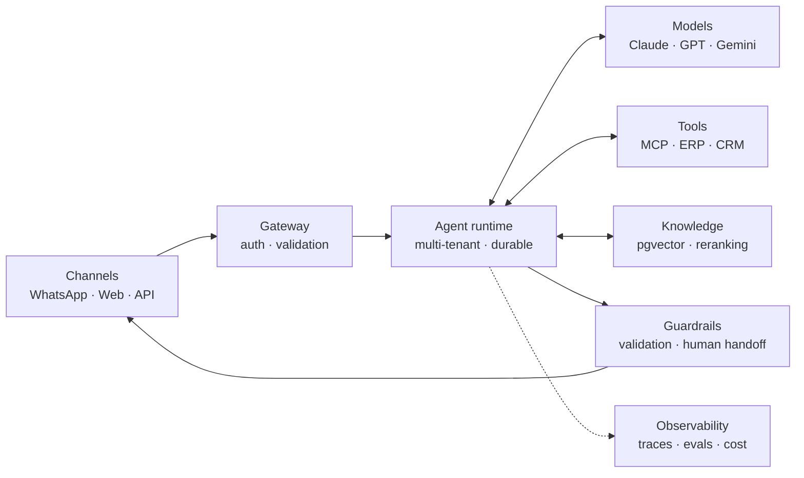

# 👋 Hi, I'm Sebastian Guerra

### Technical Lead · Full-stack Developer

Full-stack developer with **3+ years** of experience building B2B products end to end, currently completing a degree in **Computer Engineering**.
Since 2026 I've been Technical Lead, owning the architecture and engineering standards for a portfolio of multi-tenant SaaS products
in legal-tech, payroll, corporate compliance, public-sector budgeting, regulated gaming and billing,
and for the AI agent platform that powers them.
I design the systems, write code across the full stack and set how the team builds and ships.

---

## 🧭 What I Do

- 🏗️ **Architecture** for multi-tenant SaaS: tenant isolation, durable processing, payment and e-invoicing integrations.
- 🤖 **AI agents in production**, grounded in business data and built to be reliable.
- 👥 **Technical leadership**: architecture decisions, code review, standards and CI/CD.

---

## 🤖 AI Agents

With my team, we've shipped agents that:

- 🛒 Close sales end to end against an ERP.
- ⚖️ Solve legal and financial calculations without guessing a single number.
- 💬 Serve customers on WhatsApp and hand off to a human when needed.
- 🎙️ Turn meetings into summaries and actionable tasks.
- 🧱 Run on a multi-tenant platform where each company manages its own agents.

**How they're built:** grounded in real data · deterministic guardrails · tenant isolation · durable execution · provider-agnostic · sandboxed · continuously evaluated.

---

## 🧩 Open Source

- **[Praxis](https://github.com/SebastianDevps/praxis)**: spec → build → review → ship workflow for AI coding agents (Claude Code, Codex, Cursor, Gemini CLI, Copilot).
- **[git-commit-validator](https://www.npmjs.com/package/@sebastiandevp/git-commit-validator)**: commit-convention validator on npm.
- **[Engram](https://github.com/SebastianDevps/engram)**: fixes to a persistent memory store for coding agents.

---

## 💻 Tech Stack

  
  
  
  
  
  
  
  
  

  
  
  
  
  
  

  
  
  
  
  

---

## 📊 GitHub Stats

---

## 🤝 Connect With Me

  
  
  

